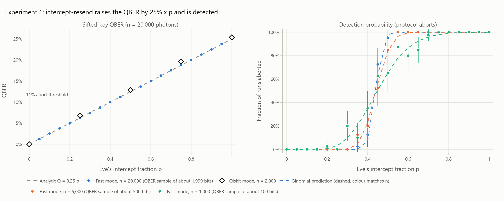
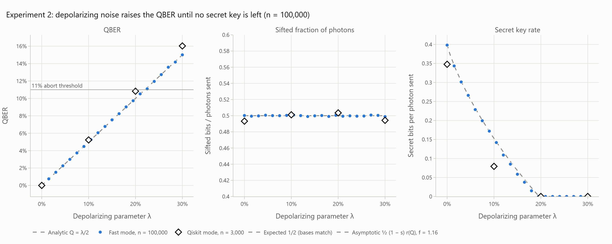
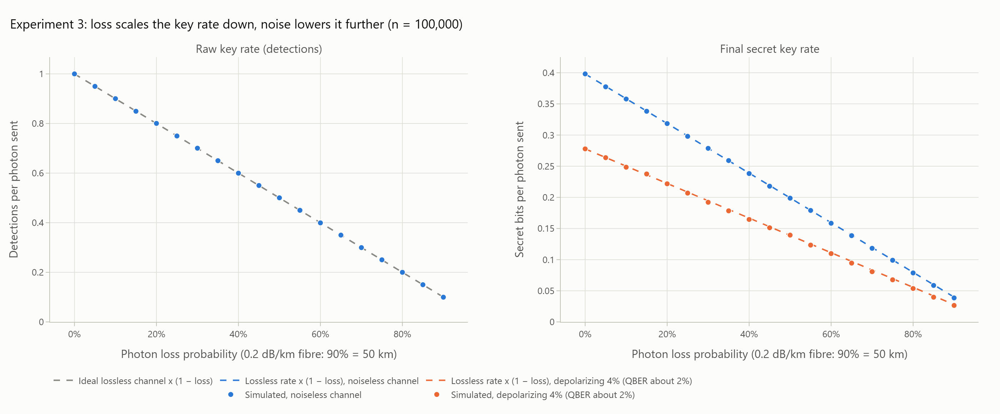
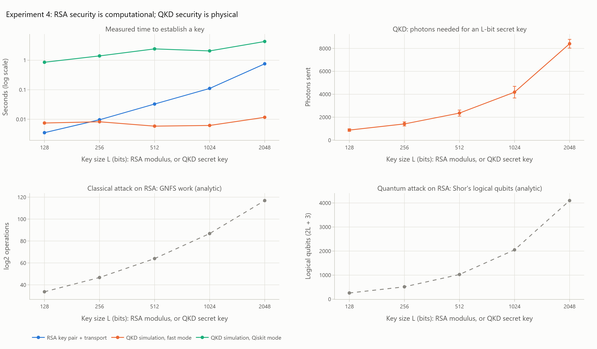

# BB84 QKD Simulator

A BB84 quantum key distribution simulator in Python and Qiskit. Alice sends
qubits to Bob, an eavesdropper (Eve) and a noisy, lossy channel can act on
them, and classical post-processing (sifting, QBER estimation, Cascade error
correction, privacy amplification) turns what survives into a shared secret
key. A Streamlit dashboard runs the protocol interactively.

It has two simulators with one interface:

* **Qiskit mode** builds one real circuit per photon and runs it on Aer. It is
  slower but demonstrable.
* **NumPy fast mode** applies the same physics to arrays, for sweeps of 10^5+
  photons. Tests validate it against Qiskit mode.

Every experiment writes a CSV with its seed and parameters, so every plotted
or quoted number traces back to a run on disk.

## Results at a glance

All numbers below come from the CSVs in `results/` (master seed 2026) and can
be reprinted with `python -m experiments.summarize`.

| Check | Prediction | Measured | Source |
| --- | --- | --- | --- |
| QBER, no Eve, no noise | 0 | 0.0000 | `exp2_channel_noise.csv`, λ = 0 |
| QBER, Eve intercepts every photon | 25% | 24.99% (n = 20,000, 40 runs) | `exp1_eavesdropping.csv` |
| QBER, Eve intercepts fraction p | 0.25 p | within 0.0007 of 0.25 p for all 21 values of p | `exp1_eavesdropping.csv` |
| Qiskit mode, full intercept | 25% | 25.37% (n = 2,000, 3 runs) | `exp1_eavesdropping.csv` |
| QBER, depolarizing λ | λ/2 | within 0.0015 of λ/2 over 0 to 30% | `exp2_channel_noise.csv` |
| Sifted fraction | 1/2 | 0.499 to 0.501 | `exp2_channel_noise.csv` |
| Cascade efficiency f | 1.1 to 1.2 (plan) | 1.15 to 1.23 | `exp2_channel_noise.csv` |
| Secret key reaches zero | QBER near 11% | λ = 0.195 (QBER 9.7%), with measured f ≈ 1.2 | `exp2_channel_noise.csv` |
| Final rate under loss | lossless rate x (1 - loss) | at most 1.4% below up to 60% loss; 3.3% (noiseless) and 4.8% (QBER ≈ 2%) below at 90% loss (50 km) | `exp3_photon_loss.csv` |
| Photons for a 2048-bit key (QBER ≈ 2%) | (measured) | 8,408 | `exp4_classical_baseline.csv` |
| RSA-2048 key pair + key transport, pure Python | (measured) | 0.50 s | `exp4_classical_baseline.csv` |






## Setup

Python 3.11 or newer; the pinned versions were verified on 3.13.

```bash
python -m venv .venv
# Windows: .venv\Scripts\activate      macOS/Linux: source .venv/bin/activate
pip install -r requirements.txt
pytest                                  # 173 tests, about 20 s
```

PNG export uses `kaleido`, which drives an installed Chrome. On a machine
without Chrome, run `kaleido_get_chrome` once. HTML plots and the dashboard
do not need it.

The project uses the current Qiskit 2.x API (`AerSimulator.run`). The removed
`qiskit.execute` is not used, and a test checks for that.

## Quick start

```python
from qkd.channel import Channel
from qkd.attacks import InterceptResend
from qkd.noise import Depolarizing, PhotonLoss
from qkd.pipeline import run_qkd

channel = Channel((InterceptResend(0.2), Depolarizing(0.04), PhotonLoss(0.3)))
result = run_qkd(20_000, channel, mode="numpy", seed=1)   # or mode="qiskit" (up to a few thousand photons)
print(result.summary())          # QBER, key lengths, Cascade leakage, status, ...
print(result.keys_match)         # True when both parties hold the same final key
```

## Running the experiments

Each script writes `results/<name>.csv`, `.html` (interactive) and `.png`
(for the report). The plot is drawn from the CSV file on disk, never from
memory.

| Command | What it sweeps | Full run |
| --- | --- | --- |
| `python -m experiments.exp1_eavesdropping` | Eve's intercept fraction 0 to 1; n = 1,000, 5,000, 20,000; 40 runs each; Qiskit-mode checks | about 15 s |
| `python -m experiments.exp2_channel_noise` | depolarizing λ 0 to 30%, n = 100,000, full pipeline; Qiskit-mode checks | about 30 s |
| `python -m experiments.exp3_photon_loss` | loss 0 to 90% (0 to 50 km), noiseless and 4% depolarizing | about 16 s |
| `python -m experiments.exp4_classical_baseline` | key size 128 to 2048: RSA against QKD | about 11 s |
| `python -m experiments.summarize` | prints the headline numbers from every CSV | instant |

Options: `--quick` runs a tiny sweep (seconds), `--seed N` sets the master
seed (default 2026), and `--plot-only` redraws the figures from the existing
CSV.

**CSV format.** The first line is a JSON comment: experiment name, master seed,
every config parameter, library versions, machine and time. Then comes one row
per simulation run, each with its own seed:

```
# {"experiment": "exp1_eavesdropping", "seed": 2026, "params": {...}, "versions": {...}, ...}
mode,n,intercept_fraction,seed,sifted_length,sample_size,qber_estimate,qber_true,aborted,...
```

Read it with `qkd.results_io.read_results_csv(path)`, which returns
`(metadata, DataFrame)`. To reproduce any single point, rerun its row with the
row's seed, for example `run_bb84(n, Channel((InterceptResend(p),)), seed=row_seed)`.

## Dashboard

```bash
streamlit run app/streamlit_app.py
```

The sidebar has:

* **Simulator:** mode (fast, or Qiskit for up to 5,000 photons), photon count and seed;
* **Eve and the channel:** Eve's intercept fraction, depolarizing λ, bit-flip, detector readout error, and loss as a probability or a fibre distance;
* **Protocol:** abort threshold and QBER sample fraction.

The page shows the status (secure key, no secret bits left, or aborted) and
five metrics, then four tabs:

1. **Photons and circuits:** the first 16 photons step by step (Alice's state, Eve, Bob's basis, sifting, errors) and the Qiskit circuit of any photon.
2. **QBER and security:** this run against Q = 0.25 p, and on the r(Q) curve.
3. **Key pipeline:** key length after each stage, and both parties' final keys.
4. **Experiment results:** the saved figures, rebuilt from their CSVs.

## How it fits together

```
          Member A                 Member B                    Member A                Member C
 Alice ──────────────► Channel (Eve, noise, loss) ──────────► Bob ──► sift ──► QBER ──► Cascade ──► Toeplitz ──► secret key
 prepare_alice()        ChannelEffect objects                 measure   sift()  estimate  cascade()   amplify()
 (qkd/core.py)          (qkd/attacks.py, noise.py)            (core)    (sifting)(qber)   (errorcorrection)(privacy)
                                                                                 └ abort if Q > threshold      keyrate.py sets the length
```

**Shared interfaces**, agreed first so the three modules could be built in parallel:

* `qkd/key.py` holds frozen data types with read-only arrays:
  * `Key`, a bit string with `error_rate`, `select` and `without`;
  * `AlicePrep`, Alice's bits and bases;
  * `Photons`, qubits in flight in the fast mode: each one is a BB84 eigenstate (basis, value), plus a lost flag;
  * `BobMeasurement`, Bob's bases, bits and detection flags.
* `qkd/channel.py` holds `ChannelEffect`, the one interface every attack and
  noise model implements. One effect object works in both simulators:
  * `sample(n, rng)` pre-draws the effect's classical randomness, so both modes see the same attack;
  * `transmit_numpy` applies the effect in fast mode;
  * `append_to_circuit` adds its gates in Qiskit mode;
  * `noise_terms` returns Aer noise-model entries;
  * `detect_numpy` covers detector effects;
  * `lost_mask` reports lost photons.

  `Channel` composes effects in order.

**Reproducibility.** One master seed is split into four independent streams:

| Stream | Draws |
| --- | --- |
| Protocol | Alice's bits and bases, Bob's bases, channel plans |
| Measurement | Quantum outcomes |
| Sampling | The QBER sample |
| Reconciliation | Cascade shuffles, verification hash, Toeplitz seed |

So for one seed, fast mode and Qiskit mode make identical classical choices
and differ only in the quantum measurement outcomes.

## Member A: core protocol

**Files:** `qkd/core.py`, `qkd/sifting.py`, `qkd/qber.py`.
**Tests:** `test_core.py`, `test_sifting_qber.py`, `test_mode_agreement.py` (38 tests).

**Quantum ideas to present**

* **Qubits and superposition.** `encode_qubit` prepares the four BB84 states:
  X for bit 1, then H for the diagonal basis. That gives |0>, |1>,
  |+> = (|0> + |1>)/√2 and |-> = (|0> - |1>)/√2. A statevector test checks all four.
* **Measurement and collapse.** `measure_qubit` measures in Z, or applies H
  first to measure in X. In the matching basis the outcome is deterministic.
  In the other basis it is 50/50, because Z and X are mutually unbiased
  (|<0|+>|² = 1/2). A test checks both cases in both simulators.
* **Sifting.** `sift` keeps detected positions where the bases match, about
  half of them (measured: 0.499 to 0.501 in experiment 2).
* **QBER estimation.** `estimate_qber` sacrifices a random 20% of the sifted
  key, because the compared bits become public, and aborts above 11%.
  `QberEstimate.upper_bound` gives a Wilson confidence bound, which error
  correction uses to size its blocks.

**Two simulators.**

* `QiskitSimulator` builds `photon_circuit(...)` for each photon: Alice's
  preparation, a `send` barrier, the channel's gates, a `receive` barrier, then
  Bob's measurement. It runs all of them as one Aer batch.
* `NumpySimulator` does the same with arrays, and is exact for these effects
  because each one maps BB84 eigenstates to BB84 eigenstates (or to mixtures
  of them).
* `tests/test_mode_agreement.py` runs both on eight channels with the same
  seed. It checks that the sifted positions are identical and that the QBERs
  agree with each other and with theory.

**Demo:** use the dashboard's *Photons and circuits* tab, and step through
photons with matching and mismatched bases.

**Likely questions**

* *Why discard half the photons?* When the bases differ, Bob's result is
  random and uncorrelated with Alice's bit.
* *Why sacrifice bits for the QBER?* Comparing them publicly tells Eve
  their values, so they can no longer be part of the key.
* *How do you know fast mode is right?* It agrees with the Qiskit circuits on
  every effect: QBER within 4.5 combined standard errors, and identical sifted
  positions.

## Member B: attacks and noise

**Files:** `qkd/attacks.py`, `qkd/noise.py`.
**Tests:** `test_attacks.py`, `test_noise.py` (36 tests), plus mode agreement.

**Quantum ideas to present**

* **No-cloning.** Eve cannot copy an unknown qubit, so to learn anything she
  must measure it and resend a replacement. In Qiskit mode,
  `InterceptResend.append_to_circuit` adds a real mid-circuit measurement in
  her random basis, into her own `eve` register. The collapsed qubit is the
  state Bob receives.
* **Disturbance implies detection.** Eve picks the wrong basis half the time,
  and then Bob's bit is wrong half the time, so Q = 1/2 x 1/2 = 25%. If she
  attacks a fraction p of the photons, Q = 25% x p.
  * Measured: 24.99% at p = 1, and within 0.0007 of 0.25 p for every p.
  * `detection_probability` gives the exact binomial chance that the QBER
    sample triggers an abort.
* **What the threshold misses.** Below about p = 0.44, Eve's QBER stays under
  11%, so the threshold does not stop her. Measured: at p = 0.4 the abort rate
  is 35%, 20% and 12.5% for n = 1,000, 5,000 and 20,000. Larger samples
  estimate Q more precisely, so they abort less often there. This is not a
  hole: privacy amplification removes the information she gained, because the
  key length is set from the measured Q.
* **Noise.** Each noise model is a labelled identity gate whose Aer error is
  attached to its label, so drawings show which noise acts where.

  | Model | Expected QBER |
  | --- | --- |
  | `Depolarizing(λ)` (Qiskit's convention ρ → (1 - λ)ρ + λ I/2) | λ/2 |
  | `BitFlip(p)` (X leaves \|±> unchanged) | p/2 |
  | `ReadoutNoise(p)` (an Aer `ReadoutError` on Bob's detector) | p |

* **Loss.** `PhotonLoss(p)` or `PhotonLoss.from_distance(km)` uses
  0.2 dB/km fibre, so 50 km loses 90% of photons. Loss shortens the key but
  adds no errors.

**Demo:** in the dashboard, raise Eve's slider from 0 to 1, watch the QBER
follow the dashed 25% x p line, and watch the run abort.

**Likely questions**

* *Can Eve avoid detection by attacking only a few photons?* Yes, but she then
  learns little, and privacy amplification removes what she did learn (see
  experiment 1, right panel).
* *Can noise and Eve be told apart?* No. The protocol treats all errors as
  Eve's, which is why noise lowers the key rate.

## Member C: post-processing and dashboard

**Files:** `qkd/errorcorrection.py`, `qkd/privacy.py`, `qkd/keyrate.py`,
`qkd/pipeline.py`, `app/`.
**Tests:** `test_errorcorrection.py`, `test_privacy_keyrate.py`,
`test_pipeline.py`, `test_dashboard.py` (62 tests).

**Ideas to present**

* **Cascade error correction** (`cascade`) works in passes:
  * Each pass shuffles the key and cuts it into blocks. The first block size is
    0.73/Q, and it doubles every pass.
  * Alice announces each block's parity. A block that disagrees holds an odd
    number of errors, and a binary search finds one of them.
  * Fixing a bit flips the parity of blocks from earlier passes, which are
    then searched again; this backtracking is the "cascade".
  * Every announced parity is counted as leaked to Eve. A 32-bit random hash
    then verifies that the keys match.
  * Tests:
    * the keys come out identical for QBER from 1% to 10%;
    * leakage is never below the Shannon limit n·h(Q);
    * a failed correction is caught by the hash.
* **Privacy amplification** (`ToeplitzHash`) multiplies the key by a public
  random Toeplitz matrix over GF(2), which is a universal hash family. It is
  computed as an FFT convolution and tested against the explicit matrix product.
* **Key rate** (`keyrate.py`):
  * secret fraction r(Q) = 1 - h(Q) - f h(Q), where h(Q) bounds what Eve knows
    and f h(Q) is what Cascade reveals;
  * `qber_threshold(f=1)` = 11.0%, the known one-way BB84 bound;
  * final key length = n(1 - h(Q)) - leaked bits - 2 log₂(1/ε), with ε = 10⁻¹⁰.
* **Measured results:**
  * Cascade's measured f is 1.15 to 1.23, so the key reaches zero at a QBER
    near 9.7%, before the 11% abort point.
  * Between those two values the protocol completes, but no secret bits remain.
* **Classical baseline** (experiment 4):
  * RSA's security is computational. The best classical attack (GNFS) needs
    about 2¹¹⁷ operations against RSA-2048, but Shor's algorithm breaks it in
    polynomial time with about 2L + 3 = 4,099 logical qubits.
  * QKD's security is physical, resting on no-cloning and disturbance, so it
    does not depend on any problem being hard to compute.

**Demo:** the whole dashboard, including the *Key pipeline* tab showing the key
shrinking from photons sent to final key, and the two identical final keys.

**Likely questions**

* *Why not just use the 11% threshold for the key rate?* The 11% figure
  assumes perfect error correction (f = 1). Real Cascade leaks about 20% more,
  so the key runs out sooner (experiment 2, right panel).
* *Why does privacy amplification work?* A universal hash maps keys that
  differ to outputs that collide only rarely. By the leftover hash lemma, if
  Eve's information about the input is bounded, the shorter output is
  close to uniform from her point of view.

## Design decisions and deviations from the plan

* **Experiment 2 sweeps depolarizing λ from 0 to 30%**, not 0 to 15%. In
  Qiskit's convention QBER = λ/2, so 15% would never reach the 11% threshold
  (decided with the team in phase 1).
* **Cascade block sizes use a Wilson upper bound on Q**, not the point
  estimate. With the point estimate, 59 of 300 short runs (n = 1,300) failed
  verification, because a sample that underestimated Q gave blocks too large
  for Cascade to clear. With the bound (z = 2) it was 0 of 300. The final key
  length still uses the point estimate, as in the plan's asymptotic formula.
* **Fibre noise is a labelled identity `UnitaryGate`** with Aer noise attached
  to its label. Each effect then acts at its own place in the channel, two
  effects cannot stack, and drawings name the noise.
* **Readout error and Eve.** Aer applies a `ReadoutError` to every
  measurement, including Eve's. It changes only the recorded bit, not the
  collapsed state (checked: Eve and Bob disagree in 42% of shots = 2p(1 - p)
  for p = 0.3), so Bob's statistics are correct. Only Eve's own record is
  noisy, and the protocol never uses it.
* **Experiment 4 interpretation.** "Key size L" is the RSA modulus size for RSA
  and the final secret key length for QKD.
  * The QKD channel is 4% depolarizing (QBER ≈ 2%).
  * Times are wall-clock times on the machine named in the CSV header, so they
    measure simulator cost, not real QKD hardware.
  * The attack costs are analytic: the standard GNFS heuristic with the o(1)
    term dropped, and Beauregard's 2L + 3 qubits for Shor. Replace them if the
    course notes give a different Shor cost model.
* **Files added to the suggested layout:**
  * `qkd/key.py`, the shared types;
  * `qkd/results_io.py`, traceable CSVs;
  * `qkd/pipeline.py`, the end-to-end run;
  * `app/dashboard_logic.py`, testable dashboard logic;
  * `experiments/common.py`, `rsa_baseline.py` and `summarize.py`.
* **Dependency added:** `kaleido`, approved in phase 6, for PNG export.

## Limitations

* **Asymptotic key rate:** finite-key analysis is out of scope, as the plan
  allows. At small n the sampled QBER varies a lot, and the 67-bit privacy
  margin and 32-bit verification hash become a large share of the key.
* **Ideal single-photon source:** no multi-photon pulses, so no
  photon-number-splitting attack and no decoy states.
* **One attack:** only intercept-resend is modelled, not collective or
  coherent attacks.
* **Textbook RSA:** no padding and a seeded random generator, so it is
  suitable only as a timing baseline.

## Stretch goals (not started)

Both the E91 entanglement variant with a CHSH test and the IBM Quantum
hardware run wait for the team's go-ahead, as the plan specifies.

## Layout

| Path | Owner | Contents |
| --- | --- | --- |
| `qkd/key.py`, `qkd/channel.py` | All | Shared `Key` types and the `Channel` / `ChannelEffect` interface |
| `qkd/core.py`, `sifting.py`, `qber.py` | Member A | Alice, Bob, Qiskit and NumPy simulators, sifting, QBER |
| `qkd/attacks.py`, `noise.py` | Member B | Intercept-resend Eve, detection probability, noise models, photon loss |
| `qkd/errorcorrection.py`, `privacy.py`, `keyrate.py`, `pipeline.py` | Member C | Cascade, Toeplitz hashing, key rate, end-to-end run |
| `app/streamlit_app.py`, `app/dashboard_logic.py` | Member C | Streamlit dashboard and its testable logic |
| `qkd/results_io.py` | All | CSV output with seed and parameters in every file |
| `experiments/` | All | Experiment scripts, the RSA baseline and the results summary |
| `results/` | All | CSV, HTML and PNG output of the full experiment runs |
| `tests/` | All | 173 pytest tests |
